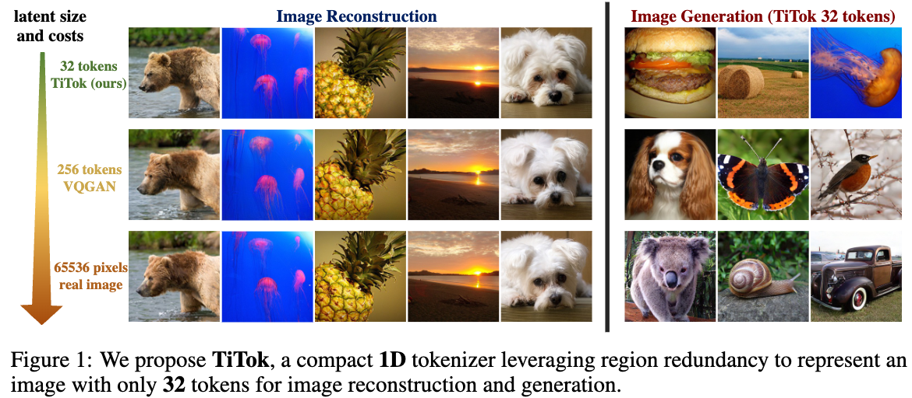
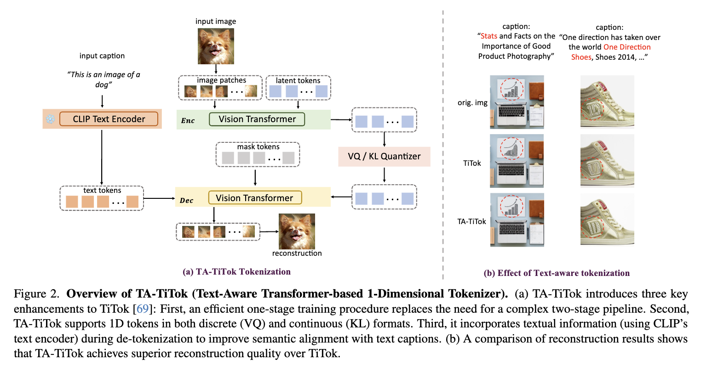

# Transformer Latent Diffusion with 1D Visual Tokenization

This repository combines a lightweight, fast, and accessible text-to-image diffusion model with cutting-edge research in 1D visual tokenization. It provides a self-contained environment to explore how text can be transformed into images and how those images can be represented with unprecedented efficiency.

This README provides a visual overview of the project and a guide to running the interactive demo.

## Overview

This project brings two powerful concepts together:

1.  **Transformer Latent Diffusion**: A text-to-image model that is small, fast, and can be trained on a single GPU. It uses a Transformer-based architecture to generate images from text prompts.
2.  **1D Visual Tokenization**: A collection of novel techniques (TiTok, TA-TiTok, MaskGen, etc.) that can represent an image with a very small number of tokens (e.g., as few as 32). This has the potential to dramatically speed up image generation and processing.

The result is a repository that is both a practical tool for generating images and a research platform for exploring the future of efficient visual representation.

## Core Technologies

### Transformer Latent Diffusion

This is a self-contained, ~100M parameter text-to-image model built in PyTorch. It's designed to be fast, with near real-time generation capabilities.

**Key Features**:
- **Fast**: Generates images in seconds.
- **Small**: ~100M parameters.
- **Simple**: The entire codebase is ~400 lines of PyTorch.
- **Trainable**: Can be trained on a single A100 GPU in under 50 hours.

Here are some examples of images generated by the model:


### 1D Visual Tokenization (TiTok, TA-TiTok, MaskGen)

This is where the cutting-edge research comes in. The `TitokTokenizer` directory contains code for several novel visual tokenization methods. These methods can represent an image with a very small number of tokens, which is a significant step towards more efficient image generation.

**Key Ideas**:
- **Compact Representation**: An image can be represented by as few as 32 tokens.
- **Text-Aware**: The tokenization process can be guided by text prompts.
- **Efficient Generation**: Leads to massive speed-ups in image generation (e.g., 410x faster than DiT-XL/2).




## Interactive Demo

This repository includes a simple interactive demo that allows you to generate images from text prompts. It consists of a FastAPI backend that serves the model and a Gradio frontend for the user interface.

### How to Run the Demo

1.  **Install Docker and Docker Compose.**
    - You can find instructions for your operating system on the [Docker website](https://docs.docker.com/get-docker/).

2.  **Set an API Token.**
    - The FastAPI application is protected by a simple token-based authentication. You'll need to set an `API_TOKEN` environment variable. You can do this by creating a `.env` file in the root of the repository with the following content:
      ```
      API_TOKEN=your-secret-token
      ```
    - Replace `your-secret-token` with any secret string you like.

3.  **Launch the application with Docker Compose.**
    - Open a terminal in the root of the repository and run the following command:
      ```bash
      docker-compose up --build
      ```

4.  **Open the Gradio UI.**
    - Once the containers are running, open your web browser and navigate to `http://localhost:7860`. You should see the Gradio interface, ready to generate images.

### Example Output

Here's an example of an image generated with the prompt "a cute grey great owl":


## Code Structure

The repository is organized into two main directories:

-   `tld`: Contains the code for the Transformer Latent Diffusion model, including the denoiser, training loop, and the FastAPI and Gradio applications.
-   `TitokTokenizer`: Contains the code for the 1D visual tokenization research, including models and experiments for TiTok, TA-TiTok, and MaskGen.

## Further Reading

This README provides a high-level overview. For more detailed information, please see the original README files:

-   [**Transformer Latent Diffusion README**](README.md): For details on the diffusion model, training, and architecture.
-   [**1D Visual Tokenization README**](TitokTokenizer/README.md): For a deep dive into the research behind TiTok, TA-TiTok, and MaskGen.